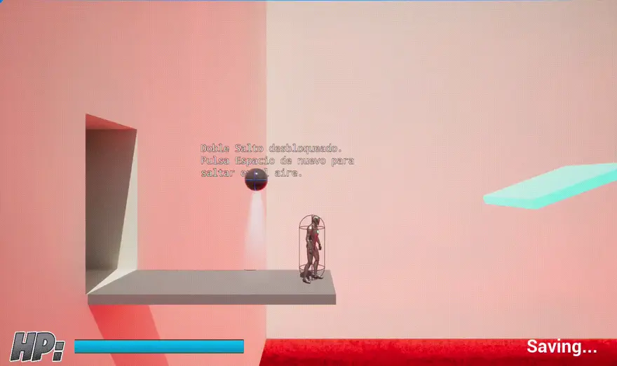
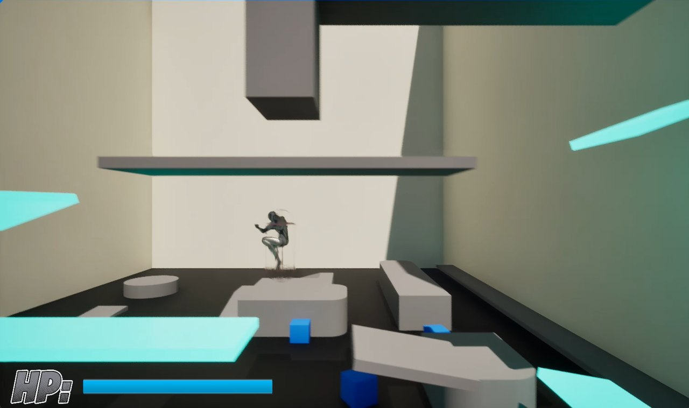
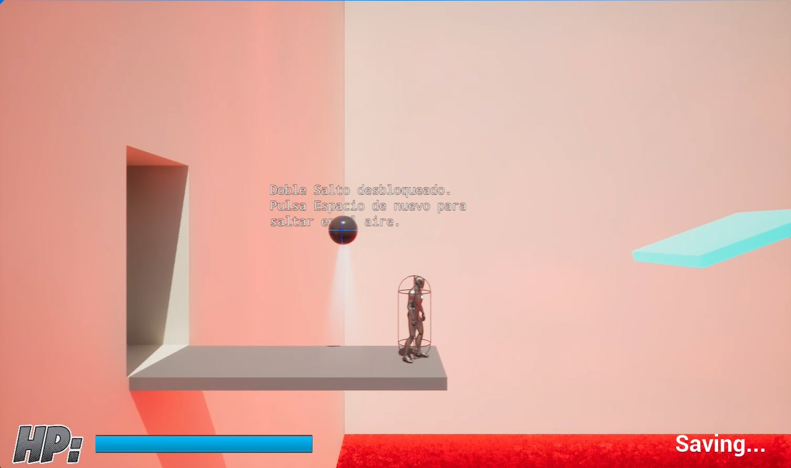

<div align="center">

# 🧪 Plataformas 2D (Unreal Engine)

**Plataformas 2D con forma de complejo de entrenamiento: un nivel tutorial en el que desbloqueas habilidades, con guardado de partida y menú de juego, hecho con Blueprints**

[]()
[]()
[]()

</div>

---

## 📖 Sobre el proyecto

Un plataformas visto de lado que se plantea como un **complejo de entrenamiento**: cada zona te enseña algo y por el camino desbloqueas habilidades, como el **doble salto**. Tiene **sistema de guardado** (con aviso en pantalla), barra de vida y un **menú de juego** para empezar la partida.

> 📌 **Proyecto académico** de la asignatura *Programación y Arquitectura de Videojuegos* del *Máster en Diseño y Desarrollo de Videojuegos* de la **UNIR**, hecho con Unreal Engine 5.5. El curso también incluyó un plataformas distinto hecho con Unity: [UNIR_Plataformas2D](https://github.com/unaigb/UNIR_Plataformas2D).

---

## 🖼️ Capturas

<p align="center">
  
</p>

<p align="center">
  
  
</p>

<p align="center"><em>Salto entre plataformas y el aviso de habilidad desbloqueada junto al guardado de la partida.</em></p>

---

## 🎮 Cómo se juega

- **Avanza por el complejo** saltando entre plataformas.
- **Desbloquea habilidades:** al conseguir una, un mensaje te explica cómo usarla (por ejemplo, *«Pulsa Espacio de nuevo para saltar en el aire»* con el doble salto). También hay *dash* y agacharse entre las acciones del proyecto.
- **Tu vida** aparece en la barra *HP* de la esquina inferior izquierda.
- **La partida se guarda** (un aviso lo indica en pantalla) y el juego tiene su propio menú.
- **Pausa** con `Esc`.

### 🕹️ Controles

| Acción | Entrada |
| :--- | :--- |
| Moverse | Teclado o mando |
| Saltar (y saltar de nuevo en el aire, con el doble salto) | `Espacio` |
| Pausa | `Esc` |

---

## ✨ Qué incluye

- **Todo en Blueprints:** personaje, HUD, mensajes, guardado y elementos del nivel. El proyecto no tiene código C++.
- **Habilidades desbloqueables** con un Blueprint de recogida y un tipo enumerado (`PowerType`).
- **Guardado de partida** con una clase de *SaveGame* y una *Game Instance*.
- **Elementos de nivel:** puntos de control, zonas de tutorial, muros que se rompen y una zona de victoria.
- **HUD** con barra de vida y widget de mensajes en pantalla.
- **Menú principal** (`ThirdPerson/Maps/MainMenu`) y nivel jugable (`00_Plataformas_2D/Levels/MainLevel`).
- **Un rifle y sus balas**, como Blueprints, y sonidos para el salto, el *dash*, las vidas extra y la música de fondo.
- **Entrada con Enhanced Input.**

---

## 🚀 Cómo ejecutarlo

**Requisitos:** [Unreal Engine 5.5](https://www.unrealengine.com/download) (Epic Games Launcher).

1. Clona el repositorio o descárgalo.
2. Haz doble clic en `Plataformas_2D_UNIR.uproject` y abre el proyecto con Unreal Engine 5.5 (la primera vez compila *shaders* y tarda un rato).
3. Para ver el **menú de juego**, abre el mapa `Content/ThirdPerson/Maps/MainMenu` y pulsa **Play**. Para ir directo al nivel, abre `Content/00_Plataformas_2D/Levels/MainLevel`.

No hay una versión compilada publicada.

---

## 📂 Estructura del repositorio

```
UnaiGB_UNIR_Plataformas2D/
├── Config/                          # Ajustes del proyecto (mapa por defecto, entrada...)
├── Content/
│   ├── 00_Plataformas_2D/           # Nivel jugable y armas
│   ├── ThirdPerson/                 # Blueprints, mapas (incluido el menú), entrada y materiales
│   ├── Sounds/                      # Salto, dash, vidas extra y música
│   └── Characters/ · AnimStarterPack/ · FPS_Weapon_Bundle/ · StarterContent/
├── Media/                           # Capturas y animación
└── Plataformas_2D_UNIR.uproject
```

---

## 🖥️ Stack tecnológico

| Categoría | Herramientas |
| :--- | :--- |
| **Motor** | Unreal Engine 5.5 |
| **Lógica** | Blueprints |
| **Entrada** | Enhanced Input |

---

## 🎨 Créditos de terceros

Este repositorio incluye recursos de otros autores, que conservan sus propias licencias: la plantilla *Third Person*, el maniquí y el paquete de animaciones de Epic Games, el paquete de armas en primera persona, el contenido de ejemplo de Unreal Engine y la música y los efectos de sonido, según el nombre de los ficheros.

---

## 👤 Autoría

**Unai García** — Máster en Diseño y Desarrollo de Videojuegos (UNIR)

- 🐙 GitHub: [@unaigb](https://github.com/unaigb)
